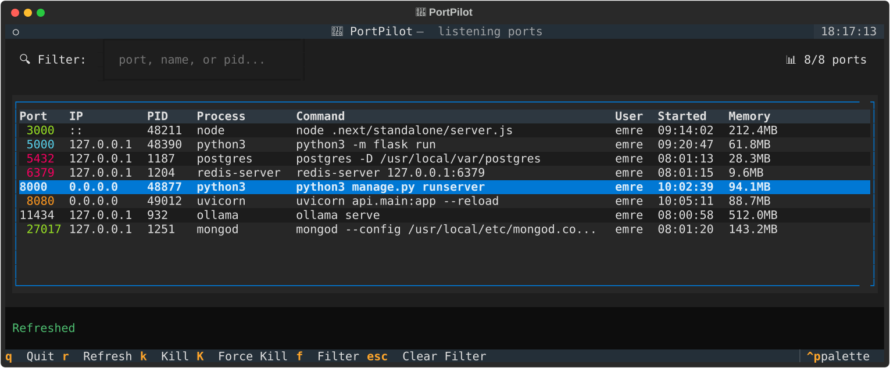

# 🛫 PortPilot

[](https://github.com/cyber-emreclskn/portpilot/actions/workflows/ci.yml)
[](https://codecov.io/gh/cyber-emreclskn/portpilot)
[](https://pypi.org/project/portpilot/)
[](https://pypi.org/project/portpilot/)
[](https://scorecard.dev/viewer/?uri=github.com/cyber-emreclskn/portpilot)
[](LICENSE)
[](https://github.com/astral-sh/ruff)

**Interactive terminal port manager for developers**

Tired of running `lsof -i :3000` and then `kill -9 <pid>` every time? PortPilot gives you a beautiful TUI to see all listening ports and kill them with a keystroke.



<!-- Regenerate: `uv run python docs/render_screenshot.py` · Animated demo: `vhs docs/demo.tape` -->

## ✨ Features

- 🖥️ **Interactive TUI** - Navigate with keyboard, search, and kill processes instantly
- 🔍 **Real-time filtering** - Filter by port, process name, PID, or command line
- 🎨 **Highlighting** - Common dev ports (3000, 8000, 5432, etc.) are color-coded
- ⚡ **Quick commands** - CLI mode with meaningful exit codes for scripting and one-liners
- 📊 **Detailed info** - See memory usage, start time, command line, and more
- 👀 **Watch mode** - Monitor specific ports in real-time
- 💻 **Cross-platform** - Linux, macOS (no `sudo` needed for your own processes) and Windows

## 📦 Installation

```bash
# Recommended: isolated install
uv tool install portpilot      # or: pipx install portpilot

# Or with pip
pip install portpilot
```

Try it without installing:

```bash
uvx portpilot
```

## 🚀 Usage

### Interactive TUI

Just run:

```bash
portpilot
# or use the short alias
pp
```

**Keyboard shortcuts:**

| Key | Action |
|-----|--------|
| `↑/↓` | Navigate |
| `k` | Kill selected process (SIGTERM, with confirmation) |
| `K` | Force kill (SIGKILL, no confirmation) |
| `r` | Refresh list |
| `f` or `/` | Focus filter (`Enter` returns to the table) |
| `Esc` | Clear filter |
| `q` | Quit |

### CLI Commands

```bash
# List all listening ports
pp list

# Filter by port
pp list -p 3000

# Filter by name
pp list -n python

# Output as JSON (great for scripting)
pp list --json

# Kill a specific port
pp kill 3000

# Force kill
pp kill 3000 -f

# Skip confirmation
pp kill 3000 -y

# Kill multiple ports
pp killall 3000 8000 5432

# Get detailed info about a port
pp info 3000

# Watch specific ports (refresh every second)
pp watch 3000 8000 -i 1

# Watch all ports
pp watch
```

### Exit codes

| Code | Meaning |
|------|---------|
| `0` | Success |
| `1` | Nothing listening on the port, or the kill failed |
| `2` | You declined the confirmation prompt |

## 🎨 Port Colors

| Color | Ports | Common Use |
|-------|-------|------------|
| 🟢 Green | 3000, 3001, 27017 | React, Next.js, MongoDB |
| 🟡 Yellow | 8000, 8080 | Django, General |
| 🔵 Cyan | 5000, 5001 | Flask |
| 🟣 Magenta | 5432 | PostgreSQL |
| 🔴 Red | 6379 | Redis |

## 🔧 Examples

### Free a port before starting a dev server

```bash
# `|| true` so the server still starts when nothing was listening
pp kill 3000 -y || true; npm run dev
```

### Find what's using a port

```bash
pp info 8000
```

### Kill all common dev ports

```bash
pp killall 3000 3001 8000 8080 5000 -y
```

### Script integration

```bash
# Check if port is in use
if pp list -p 3000 --json | jq -e '.[0]' > /dev/null; then
    echo "Port 3000 is in use"
fi
```

## 🖥️ Platform notes

- **macOS:** listing every socket on the system requires root. Without it, PortPilot automatically falls back to per-process lookup, which shows all ports opened by *your* processes — usually exactly what you need during development. Use `sudo pp` to see system services too.
- **Linux:** processes owned by other users show up with limited details unless you run with `sudo`.
- **Windows:** run the terminal as Administrator to inspect or kill services.

## 🛠️ Development

PortPilot uses [uv](https://docs.astral.sh/uv/) for environments and dependencies.

```bash
git clone https://github.com/cyber-emreclskn/portpilot.git
cd portpilot
uv sync                       # creates .venv with dev dependencies
uv run pre-commit install     # ruff + mypy on every commit

uv run pytest --cov           # tests (unit, CLI and headless TUI)
uv run ruff check . && uv run ruff format .
uv run mypy
uv run portpilot              # run your local checkout
```

See [CONTRIBUTING.md](CONTRIBUTING.md) for the full workflow, including commit message conventions and how releases work.

## 🤝 Contributing

Contributions are welcome! Check the [good first issues](https://github.com/cyber-emreclskn/portpilot/labels/good%20first%20issue) and read [CONTRIBUTING.md](CONTRIBUTING.md). Please report security issues privately as described in [SECURITY.md](SECURITY.md).

## 📄 License

MIT License - see [LICENSE](LICENSE) for details.

---

Maintained by **Emre Çalışkan** · Made with ❤️ for developers who are tired of port conflicts
